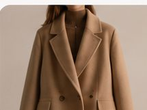
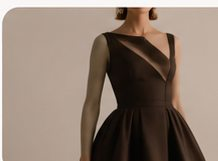
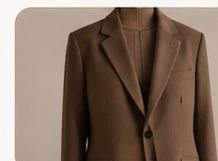
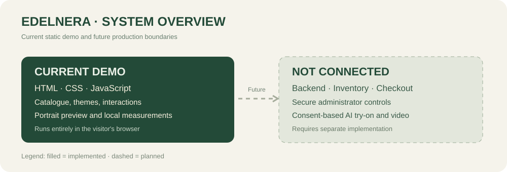
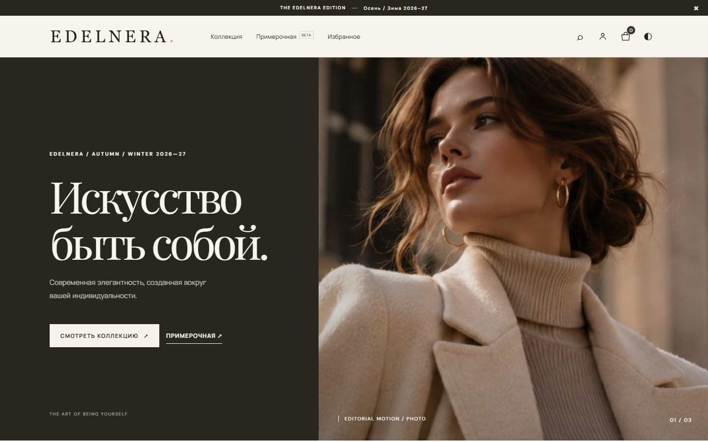
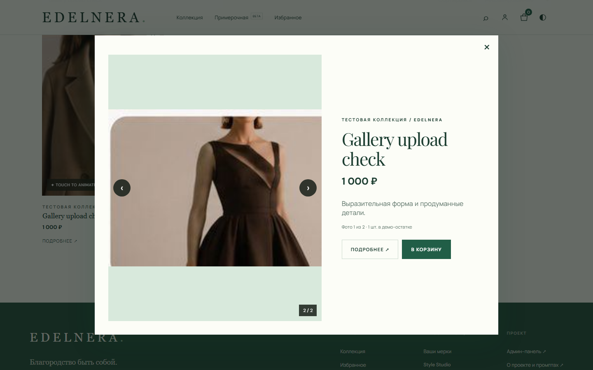
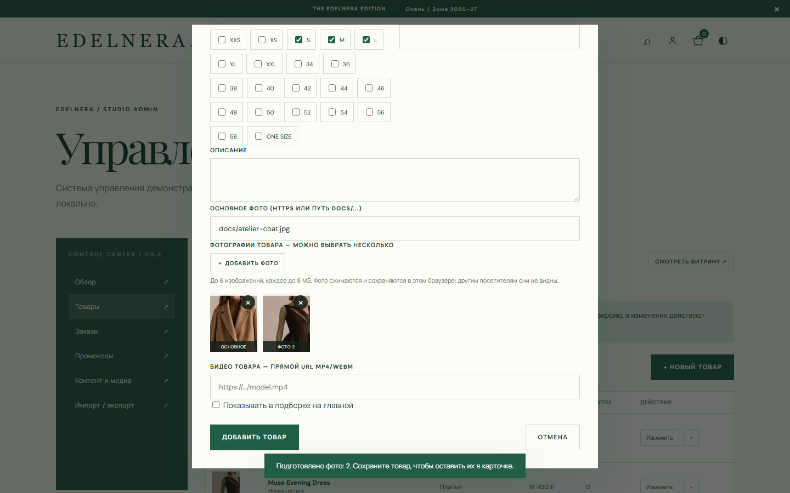

<div align="center">
  
  <h1>E D E L N E R A</h1>
  <h3>The art of being yourself.</h3>
  <p>Next-generation fashion atelier · Editorial design · Personalized styling</p>
  <p>
    <a href="https://genocide12.github.io/EDELNERA/"><strong>EXPLORE THE DEMO ↗</strong></a>
    &nbsp;&nbsp;·&nbsp;&nbsp;
    <a href="https://github.com/Genocide12/EDELNERA/releases"><strong>RELEASES ↗</strong></a>
    &nbsp;&nbsp;·&nbsp;&nbsp;
    <a href="https://github.com/Genocide12/EDELNERA/actions"><strong>VISUAL QA ↗</strong></a>
  </p>
  <p><sub>⚠️ The demo link becomes available only after GitHub Pages is enabled in this repository's Settings → Pages.</sub></p>
</div>

---

## A contemporary fashion experience

EDELNERA is a working, mobile-first **interactive storefront prototype**, not merely a static mockup. Move between pages, customize your style profile, create a local demo order, and manage a sample catalogue in Admin Studio.

| Atelier outerwear | Evening silhouettes | Signature accessory | Modern tailoring |
|:---:|:---:|:---:|:---:|
|  |  |  |  |

*Illustrative demo imagery — not a real inventory or an indication of product photography licensing for production commerce.*

## Three creative directions

**01 / ATELIER** — pale stone, champagne, warm neutral.  
**02 / NOIR** — contemporary graphite-green, soft light.  
**03 / MALACHITE** — bright mineral green, botanical refinement.

Select a theme from the ◐ icon in the header or from the three creative cards on the home page. Themes persist in the current browser.

## Features implemented in v0.4.0

| Area | What works in the demo |
|---|---|
| **Homepage** | Responsive editorial composition, animated hero image, optional real MP4/WebM video URL |
| **Product gallery** | Category sections and featured collections |
| **Catalogue** | 1,398 positions transcribed from the supplied women's and men's assortment documents, search, category filtering, sorting, new/featured labels, and 24-card paging |
| **Motion** | 3.3-second animated still photos on desktop hover and iPhone tap, video playback if a URL is configured |
| **Product pages** | Details, stock indicator, selectable sizes, approximate measurement guidance, quick-view image gallery with up to six photos |
| **Wishlist** | Save and remove favourites |
| **Cart** | Quantity, sizes, deletion, stock checks and promo discounts |
| **Demo checkout** | Create a local sample order without payment, view order in customer profile |
| **Customer profile** | Height, chest, waist, hip and shoulder measurements saved locally |
| **Face photo** | Upload portrait-only image, kept only in the current browser tab |
| **Style Studio** | Face-image positioning over a garment image, adjustable scale and movement preview |
| **Admin Studio** | Product CRUD, article/brand, prices, sizes, inventory, featured items, multiple local photo uploads and a paged catalogue editor |
| **Admin orders** | List sample orders, change their local statuses |
| **Admin marketing** | Manage demo promo codes |
| **Admin content** | Hero title, season, announcement, video URL, theme switching |
| **Data portability** | Import / export JSON; reset demo data |
| **Project dossier** | Working documentation page, technology overview and reusable master prompt |

**Important boundaries.** The Admin Studio is a **browser-local public demo** without authentication. Editing a product does **not** publish changes for all shoppers. A full product backend, authenticated administration, real checkout, shipping, AI face replacement and true garment fit simulation are **not implemented**. The Style Studio makes a **manual visual composition**; its motion effect is not a generated video of the customer.

### Imported assortment

The supplied Word tables were converted into 386 women's and 1,012 men's product records. Each position uses the same temporary catalogue image until a real product photo is added in Admin Studio. Brand, article, source table, price, and listed size data are retained where present. The original files do not identify the price currency, while the demo storefront displays its configured currency symbol; confirm the source currency before using the prices commercially. The formatted workbook is available at [docs/assortment-formatted.xlsx](docs/assortment-formatted.xlsx).

### Customer experience

1. Browse products → select size → add to cart.
2. Apply the sample promo code `WELCOME10`.
3. Create a demo order → see it in Profile / Admin.
4. Upload a **face portrait only** and save body measurements.
5. Open Style Studio → place and resize the face over a concept garment image.

All demo checkout fields can use fictional details. No real payment details are requested.

### Admin Studio

Open **Admin Studio** from the footer. It has **Dashboard**, **Products**, **Orders**, **Promo codes**, **Content & media**, and **Import / export**.

Admin product imagery can be provided through a URL or by selecting up to six JPG/PNG/WebP images at once; uploads are compressed, previewed and saved only in this browser. Tap **УВЕЛИЧИТЬ ФОТО** on a catalogue card to open the larger gallery. MP4/WebM direct URLs may be configured per item and for the hero. For public production use, media should be hosted on an owned/CDN storage service under the correct licence. Avoid putting API keys or customer secrets in a static site.

## Architecture



**Now:** HTML5 · CSS3 · Vanilla JS · GitHub Pages-compatible static hosting · browser localStorage · no paid server. Product uploads are resized and kept in the current browser; multi-photo galleries are limited to six images per product.

**Later:** authenticated admin + real product database, inventory/order API, licensed image/video CDN, payment processor, AI avatar generation with explicit consent, measurement-specific size engine, privacy controls, monitoring and security auditing.

## Quality assurance

### Interface screenshots

Captured from the running demo in Chromium on desktop and iPhone-sized viewports:

| Storefront | Enlarged product gallery | Admin photo upload |
|:---:|:---:|:---:|
|  |  |  |

We run GitHub Actions checks on pull requests and main:

- **Interaction smoke tests:** navigation, search/filter logic, wishlist, cart, checkout, sample orders, admin CRUD, media controls, profile and project page.
- **Visual browser QA:** screenshots at desktop 1440×900 and iPhone-style 390×844 viewports across three themes, catalogue, Admin Studio and Style Studio. Screenshots are attached as workflow artifacts (14-day retention).

[Open visual QA and preview artifacts ↗](https://github.com/Genocide12/EDELNERA/actions/workflows/visual.yml)

## Run

```bash
# Python's built-in server is enough
python3 -m http.server 4173
# open http://localhost:4173
```

The site does not require a build tool or paid database.

### Publish with GitHub Pages (one-time owner action)

This repository currently needs its initial GitHub Pages activation. Open **Settings → Pages → Build and deployment**, select **Deploy from a branch**, then **main / (root)** and click **Save**.

The public link will then be **https://genocide12.github.io/EDELNERA/**. If it returns 404, Pages is not yet enabled or the initial deployment is still processing.

### GitHub About / Website

The `Website` field under **About** can be edited by a repository administrator. Paste `https://genocide12.github.io/EDELNERA/` when Pages is active. The current GitHub connector does not expose updating repository homepage metadata.

## Versions

- **v0.1.0:** Initial static store concept.
- **v0.2.0:** Kinetic catalogue, three themes, initial local portrait and project documentation.
- **v0.4.0:** Imported both supplied assortment tables, added paged 1,398-item catalogue/admin lists, multi-photo uploads and enlarged quick-view galleries.
- **v0.3.0:** New full-store demo, local Admin Studio, order lifecycle, media management, personalised style preview and mobile visual QA.

See [CHANGELOG](CHANGELOG.md) and [Releases](https://github.com/Genocide12/EDELNERA/releases). Releases are automatically created from the `VERSION` file after a successful push to `main`.

## Presenting the project

The site footer links to **About this project**, including a copyable implementation prompt. Use the project dossier to distinguish current demo functionality from future production architecture.

---

<div align="center">
  <strong>EDELNERA</strong><br>
  <i>Nobility is being yourself.</i><br>
  <sub>Concept edition 2026–2027 · Built to be experienced, not just viewed.</sub>
</div>
