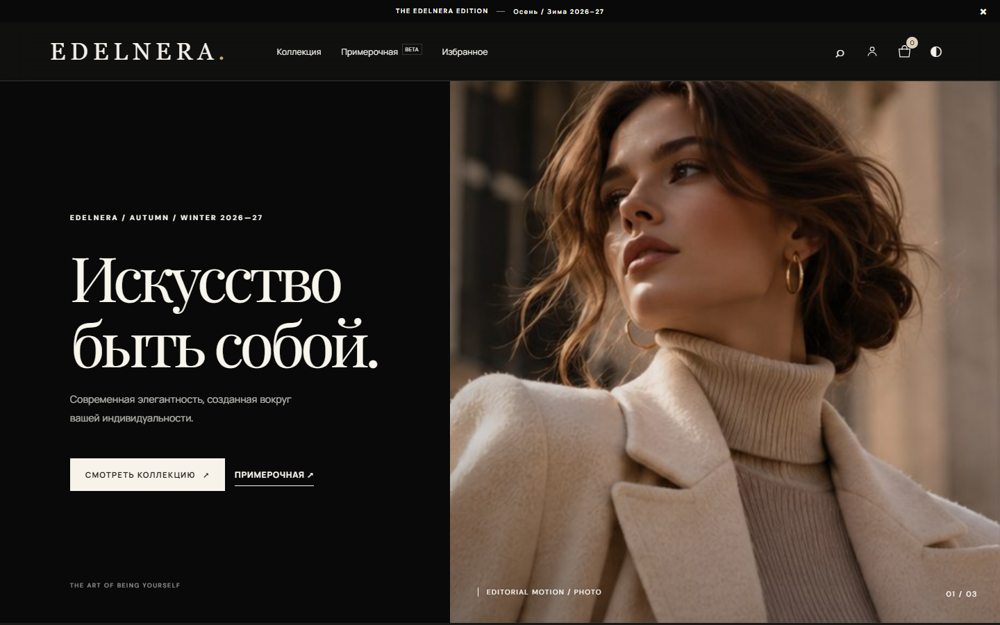
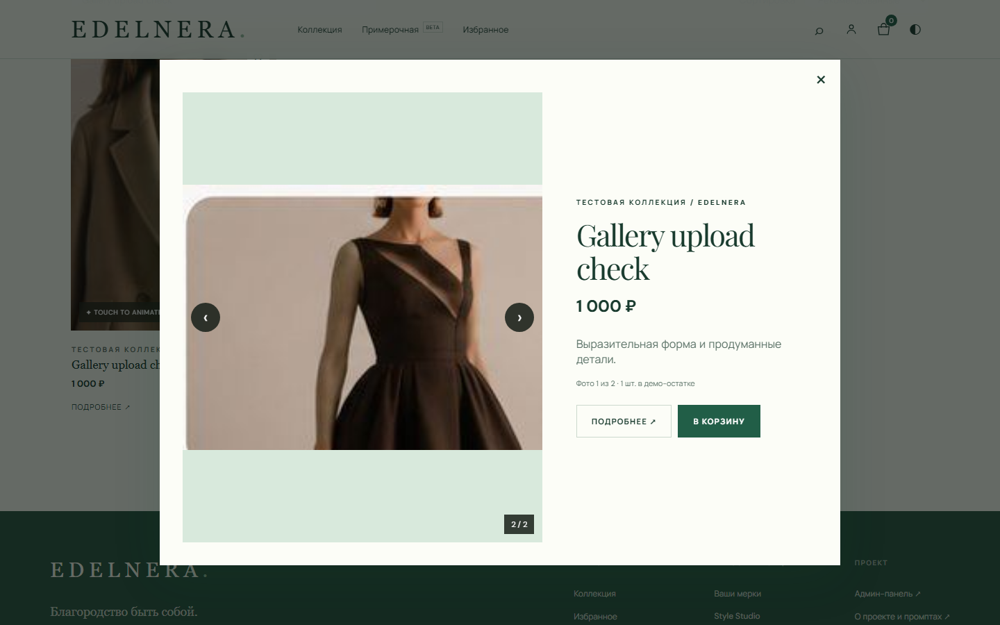
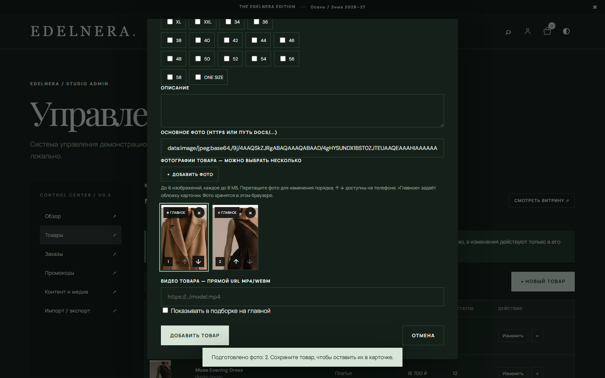

<div align="center">
  
  <h1>E D E L N E R A</h1>
  <h3>Искусство быть собой</h3>
  <p>Премиальный fashion-магазин · редакционный дизайн · персональный стиль</p>
  <p>
    <a href="https://genocide12.github.io/EDELNERA/"><strong>ОТКРЫТЬ ДЕМО ↗</strong></a>
    &nbsp;&nbsp;·&nbsp;&nbsp;
    <a href="https://github.com/Genocide12/EDELNERA/releases"><strong>РЕЛИЗЫ ↗</strong></a>
    &nbsp;&nbsp;·&nbsp;&nbsp;
    <a href="README.md">English</a>
  </p>
</div>

---

## О проекте

EDELNERA — адаптивный интерактивный прототип магазина одежды. В нём есть каталог из таблиц ассортимента, карточки товаров, избранное, корзина, демонстрационное оформление заказа и локальная демо-админка. Реальная оплата отключена.

### Дизайн-направления

- **Atelier** — тёплый чёрный фон и оттенки шампанского.
- **Noir** — графит, холодный белый и серебристые акценты.
- **Malachite** — глубокий зелёный и минеральные оттенки.

Переключатель тем находится в верхней панели. Интерфейс проверен на настольном и мобильном размерах.

## Возможности

- Каталог на 1 398 товарных позиций, поиск, категории, фильтры, сортировка и постраничная навигация.
- Карточки с размерами, ценой и остатком, избранное и корзина.
- Прикрепление до шести фото к товару, выбор главного кадра, сортировка перетаскиванием и кнопками ↑ ↓ на телефоне.
- Миниатюры фотографий сразу отображаются на карточке товара; по нажатию можно сменить основное фото или открыть галерею крупнее.
- Анимация фотографии при наведении мыши или касании. Для видео можно указать прямую ссылку на MP4/WebM.
- Демо-оформление без списания денег и редактирование созданных в браузере заказов.
- Админка для карточек товаров, фото, цен и старой цены, размеров, общего остатка, категорий, демо-заказов, промокодов и контента.
- Профиль с мерками; фотография лица остаётся только в текущей вкладке.
- Страница «О проекте» с описанием возможностей и копируемым мастер-промптом.

**Примерка не использует AI.** Style Studio показывает ручную композицию портрета поверх фото одежды. Она не генерирует новое изображение/видео и не моделирует реальную посадку вещи.

## Где хранятся товары и фотографии

В демо **нет общей базы данных и сервера загрузок**. GitHub Pages раздаёт статические файлы из репозитория.

| Данные | Где находятся | Что это означает |
|---|---|---|
| Встроенные демонстрационные товары | `assets/app.js` (`baseProducts`) | Исходные записи нескольких примеров магазина |
| Импортированные 1 398 позиций | `assets/imported-catalog.js` (`window.edelneraInventory`) | Каталог записан прямо в JavaScript-файл репозитория |
| Фото обложки и примеры | `docs/hero.jpg`, `docs/atelier-*.jpg` | Обычные файлы репозитория, доступны посетителям сайта |
| Фото импортированных товаров | Поля `image` и `images` в `assets/imported-catalog.js` | Пока у всех импортированных позиций общее шаблонное фото `docs/atelier-coat.jpg` |
| Изменения из админки | `localStorage` браузера, ключ `edelnera:atelier-v3` | Новые товары, цены, остатки, заказы, избранное, мерки, темы и фото видны только в этом браузере |
| Загруженные фото товаров | Данные изображений внутри `localStorage` | Фото сжимаются и остаются на текущем устройстве; они не отправляются в GitHub и не появляются у других посетителей |
| Фото лица | Память текущей вкладки | Удаляется при закрытии/перезагрузке вкладки и не попадает в экспорт |
| Резервная копия | Admin → «Импорт / экспорт» → JSON | Можно скачать локальные изменения и позднее импортировать их в этом браузере |

**Важно:** редактирование товара в демо-админке не меняет общий сайт и не изменяет файлы в GitHub. Для совместного управления нужны отдельные серверная база данных, защищённый API с авторизацией и хранилище фотографий/CDN. Сейчас они не подключены. В Excel остатки указаны отдельно по размерам; сайт пока использует одно суммарное поле остатка на товар.

## Ассортимент и таблица остатков

Из документов перенесены 386 женских и 1 012 мужских позиций. В книге Excel каждый размер вынесен в отдельный столбец с количеством из исходной таблицы. Если источник не указывал размер, количество записано в отдельном столбце «Размер не указан».

[Скачать отформатированную таблицу Excel](docs/assortment-formatted.xlsx)

Исходные документы не указывают валюту цен — перед коммерческим использованием её нужно подтвердить.

## Скриншоты

| Главная | Галерея товара | Загрузка фото в админке |
|:---:|:---:|:---:|
|  |  |  |

## Запуск локально

Установка зависимостей и сборка не нужны. В корне репозитория запустите:

```bash
python3 -m http.server 4173
```

Затем откройте `http://localhost:4173`. Для полноценной проверки доступны CI workflow в каталоге `.github/workflows/`.

## Публикация и версии

- [Демо на GitHub Pages](https://genocide12.github.io/EDELNERA/)
- [Репозиторий Genocide12/EDELNERA](https://github.com/Genocide12/EDELNERA)
- [История изменений](CHANGELOG.md)
- [Релизы](https://github.com/Genocide12/EDELNERA/releases)

GitHub Pages публикует статический сайт из ветки `main`. Обновление `VERSION` запускает создание релиза по workflow.

## Технические границы демо

Сейчас: HTML, CSS, JavaScript, GitHub Pages и хранилище браузера. Нет общей базы, авторизации администраторов, синхронизации каталога, реальных заказов и платежей, AI-примерки или генерации видео. В проекте не настроены серверная обработка персональных данных и система хранения медиа для всех покупателей.

Для магазина в продакшене понадобятся серверная часть с разграничением доступа, общая база каталога/заказов/остатков, CDN для лицензированных фото и видео, платёжный провайдер и отдельная интеграция примерки с согласием пользователя.
